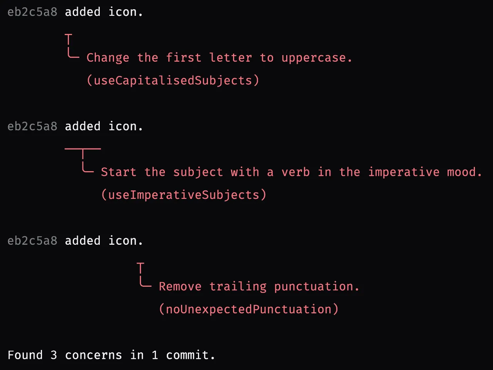

# Comet ☄️

A linter to ensure that Git commit messages conform to certain standards and conventions declared by a customisable set of rules.

> [!CAUTION]  
> Comet v2 is currently in development with an expected release later in 2026.



## Why lint commit messages?

A commit is a permanent, durable record of a change.
Its diff shows the actual file changes while the commit message may include details about assumptions and constraints that are not apparent from the diff.

Some effort in useful commit messages now will help you and your team in the future:

- **Save investigation time.**
  Knowing the motivation and circumstances behind a change helps you assess whether the change caused a regression or is safe to revert.

- **Share knowledge.**
  Capturing context and decisions gives the whole team access to information that might otherwise remain with the author.

- **Find relevant changes.**
  Consistent, predictable formatting makes commit messages easier for humans and agents to read and search.

- **Support agile workflows.**
  Teams can agree on policies that streamline code reviews by encouraging small, short-lived branches and fixup commits.

- **Focus on code instead of conventions.**
  Automated checks in local Git hooks and CI pipelines leave reviewers more time to focus on the change itself.

For example, this commit message follows the default subject and body style encouraged by Comet and explains the motivation and constraints behind the change:

```
Retry timed-out requests before payment

Transient network failures abort checkout before payment starts.
Retry these requests up to three times so customers can continue without
reloading the page.

Leave payment submissions unchanged to avoid duplicate charges.
```

Further reading:

- [Pro Git book: Commit guidelines](https://git-scm.com/book/en/v2/Distributed-Git-Contributing-to-a-Project#_commit_guidelines)
- [cbeams: How to Write a Git Commit Message](https://cbea.ms/git-commit)
- [Martijn Hols: How to write a good git commit message](https://martijnhols.nl/blog/how-to-write-a-good-git-commit-message)

## Rules

| Symbol                                       | Explanation                                                                        |
|----------------------------------------------|------------------------------------------------------------------------------------|
|  | The rule is enabled by default in the `comet` CLI on the command-line.             |
|     | The rule is enabled by default in the `rainstormy/comet` action in GitHub Actions. |

| Name                                                                       | Description                                                                                                                                                                                                                                     | Default                                                                                |
|----------------------------------------------------------------------------|-------------------------------------------------------------------------------------------------------------------------------------------------------------------------------------------------------------------------------------------------|----------------------------------------------------------------------------------------|
| [`noBlankSubjects`](docs/rules/NoBlankSubjects.md)                         | Rejects subjects without any alphanumeric characters.                                                                                                                                                                                           |   |
| [`noExcessiveCommitsPerBranch`](docs/rules/NoExcessiveCommitsPerBranch.md) | Rejects branches with more than a configured number of undelivered commits, encouraging short-lived branches and [stacked pull requests](https://docs.github.com/en/pull-requests/how-tos/create-pull-requests/creating-stacked-pull-requests). |                                               |
| [`noExcessiveWhitespace`](docs/rules/NoExcessiveWhitespace.md)             | Rejects subjects with leading, trailing, or consecutive whitespace characters, and body lines with consecutive whitespace characters.                                                                                                           |   |
| [`noMergeCommits`](docs/rules/NoMergeCommits.md)                           | Rejects commits with more than one parent commit, encouraging rebasing instead of merging to keep a branch up to date with the main branch.                                                                                                     |   |
| [`noRepeatedSubjects`](docs/rules/NoRepeatedSubjects.md)                   | Rejects subjects equal to a previous subject in the current branch.                                                                                                                                                                             |                                               |
| [`noRestrictedTrailers`](docs/rules/NoRestrictedTrailers.md)               | Rejects configured [trailers](https://git-scm.com/docs/git-interpret-trailers) in the message body.                                                                                                                                             |                                                                                        |
| [`noRevertReverts`](docs/rules/NoRevertReverts.md)                         | Rejects subjects with more than one revert marker, encouraging cherry-picking the original commit.                                                                                                                                              |                                               |
| [`noSingleWordSubjects`](docs/rules/NoSingleWordSubjects.md)               | Rejects subjects that contain only one word.                                                                                                                                                                                                    |   |
| [`noSquashMarkers`](docs/rules/NoSquashMarkers.md)                         | Rejects subjects beginning with a squash marker like `amend!`, `fixup!`, and `squash!`, reminding you to squash temporary commits before merging pull requests.                                                                                 |                                               |
| [`noUnexpectedPunctuation`](docs/rules/NoUnexpectedPunctuation.md)         | Rejects subjects with unexpected trailing punctuation.                                                                                                                                                                                          |   |
| [`useAuthorEmailPatterns`](docs/rules/UseAuthorEmailPatterns.md)           | Rejects commits where the author's email address does not match one of the configured regex patterns.                                                                                                                                           |                                                                                        |
| [`useAuthorNamePatterns`](docs/rules/UseAuthorNamePatterns.md)             | Rejects commits where the author's name does not match one of the configured regex patterns.                                                                                                                                                    |                                                                                        |
| [`useCapitalisedSubjects`](docs/rules/UseCapitalisedSubjects.md)           | Rejects subjects that start with a lowercase letter.                                                                                                                                                                                            |   |
| [`useCommitterEmailPatterns`](docs/rules/UseCommitterEmailPatterns.md)     | Rejects commits where the committer's email address does not match one of the configured regex patterns.                                                                                                                                        |                                                                                        |
| [`useCommitterNamePatterns`](docs/rules/UseCommitterNamePatterns.md)       | Rejects commits where the committer's name does not match one of the configured regex patterns.                                                                                                                                                 |                                                                                        |
| [`useConciseSubjects`](docs/rules/UseConciseSubjects.md)                   | Rejects subjects longer than the configured character limit.                                                                                                                                                                                    |   |
| [`useEmptyLineBeforeBody`](docs/rules/UseEmptyLineBeforeBody.md)           | Rejects commits whose message body is not separated from the subject (i.e. the first line) by exactly one empty line.                                                                                                                           |   |
| [`useImperativeSubjects`](docs/rules/UseImperativeSubjects.md)             | Rejects subjects that do not start with a verb in the imperative mood.                                                                                                                                                                          |   |
| [`useIssueLinks`](docs/rules/UseIssueLinks.md)                             | Rejects subjects without an issue link in the configured position.                                                                                                                                                                              |                                                                                        |
| [`useLineWrapping`](docs/rules/UseLineWrapping.md)                         | Rejects body lines longer than the configured character limit.                                                                                                                                                                                  |   |
| [`useSignedCommits`](docs/rules/UseSignedCommits.md)                       | Rejects commits without a cryptographic signature.                                                                                                                                                                                              |   |

## Command-line interface (CLI)

The Comet CLI checks the commits on the current branch that have not been delivered to the default branch, i.e. the range `origin/HEAD..HEAD` for a remote named `origin`.
If no remote exists, it checks the local range `main..HEAD` or `master..HEAD`.

It does not modify any commits.

### Usage with Node.js

Install [`@rainstormy/comet`](https://www.npmjs.com/package/@rainstormy/comet) with a package manager of your choice, for example:

```shell
pnpm add --save-dev @rainstormy/comet
```

If `node_modules/.bin/` is linked to your `PATH`, you can run Comet directly:

```shell
comet \
  [--config <path>] \
  [--default-branch <branch>] \
  [--skip-missing-configs]
```

You can also define a custom task in `package.json` or `vite.config.ts` (with [Vite+](https://viteplus.dev)):

```json
{
  "scripts": {
    "lint-commits": "comet"
  }
}
```

Run it with your package manager:

```shell
pnpm run lint-commits
```

Or with Vite+:

```shell
vpr lint-commits
```

You can also run this task in a `pre-push` Git hook to block pushes that contain poorly formatted commit messages.

### Usage with Deno

Install and run Comet directly with [Deno](https://deno.com):

```shell
deno run \
  --allow-env \
  --allow-read='comet.json,comet.jsonc' \
  --allow-run='git' \
  npm:@rainstormy/comet \
  [--config <path>] \
  [--default-branch <branch>] \
  [--skip-missing-configs]
```

If you use a custom configuration file or `extends`, add its path to `--allow-read`.

## GitHub Actions

The `rainstormy/comet` action checks the commits of the current pull request.
It must run in workflows triggered by `pull_request` events.

The `github-token` needs `pull-requests: read` permissions to allow Comet to [list the pull request's commits](https://docs.github.com/en/rest/pulls/pulls?apiVersion=2026-03-10#list-commits-on-a-pull-request).

To load a configuration file, include an `actions/checkout` step before the `rainstormy/comet` step and grant `contents: read` permissions to the `github-token`.
Use `config-path` to specify a custom configuration file path.

Example:

```yaml
name: CI

on: pull_request

jobs:
  commit-messages:
    # if: github.event_name == 'pull_request'
    runs-on: ubuntu-latest
    timeout-minutes: 1
    permissions:
      contents: read
      pull-requests: read
    steps:
      - uses: actions/checkout@3d3c42e5aac5ba805825da76410c181273ba90b1 # v7.0.1
        with:
          persist-credentials: false
      - uses: rainstormy/comet@10ac994454c2a81e76a4ff48f3d015086e708674 # v2.0.0-rc.0
        with:
          github-token: ${{ github.token }}
          config-path: .github/comet.jsonc
```

## Configuration file

To customise the configuration, create a `comet.json` (or `comet.jsonc`) file in the project root directory.
Override the settings you want to change, for example:

```json
{
  "$schema": "https://unpkg.com/@rainstormy/comet@2.0.0-rc.0/schema.json",
  "rules": {
    "noMergeCommits": "error",
    "useConciseSubjects": {
      "level": "error",
      "options": { "maxLength": 60 }
    },
    "useSignedCommits": "off"
  }
}
```

Use `--config <path>` in the CLI or `config-path` in GitHub Actions to select a different configuration path.

### `$schema`

Validate the configuration file and enable code completion with the official JSON schema:

```json
{
  "$schema": "https://unpkg.com/@rainstormy/comet@2.0.0-rc.0/schema.json"
}
```

### `extends`

Inherit settings from another configuration file.

The path is resolved relative to the configuration file declaring the `extends` field.
Settings in the declaring configuration override inherited settings, except arrays which are combined; hence, empty arrays will not clear inherited entries.

Example:

```json
{
  "extends": "./comet.base.json",
  "rules": {
    "noSquashMarkers": "error"
  }
}
```

### `git.defaultBranch`

Hardcode the 'from ref' of the checked commit range instead of computing it from `origin/HEAD`.

The `--default-branch` CLI flag takes precedence over `git.defaultBranch`.

Example (range of `origin/next..HEAD`):

```json
{
  "git": {
    "defaultBranch": "origin/next"
  }
}
```

### `tokens.issueLinks`

Declare which words to recognise as issue links.

- `prefixes` (array of strings): Issue number prefixes. For instance, `#` and `NEOWISE-` will recognise issue links like `#123` and `NEOWISE-456`. Default value: `[]`.
- `wildcards` (array of strings): Literal labels such as `(no-issue)` and `[incident]`. Default value: `[]`.

If both arrays are empty, no issue links are recognised.
To require issue links in subjects, enable the [`useIssueLinks`](docs/rules/UseIssueLinks.md) rule.

Example (GitHub-style issue links with Renovate-style critical security upgrades):

```json
{
  "tokens": {
    "issueLinks": {
      "prefixes": ["#", "GH-"],
      "wildcards": ["[SECURITY]"]
    }
  }
}
```

Example (Jira-style issue links):

```json
{
  "tokens": {
    "issueLinks": {
      "prefixes": ["NEOWISE-"]
    }
  }
}
```
