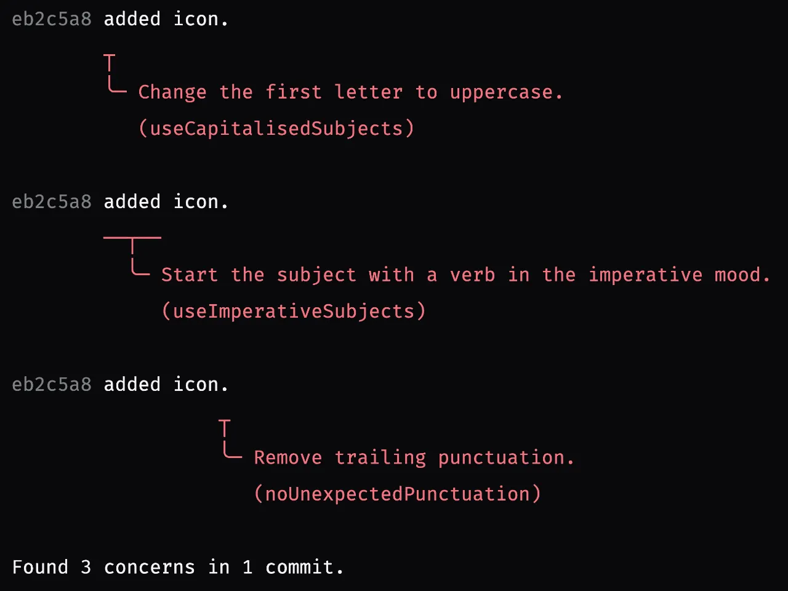

# Comet ☄️

A linter to ensure that Git commit messages conform to certain standards and conventions declared by a customisable set of rules.



## Why lint commit messages?

A commit is a permanent, durable record of a change.
Its diff shows the actual file changes while the commit message may include details about assumptions and constraints that are not apparent from the diff.

Some effort in useful commit messages now will help you and your team in the future:

- **Save investigation time.**
  Knowing the motivation and circumstances behind a change helps you assess whether the change caused a regression or is safe to revert.

- **Share knowledge.**
  Capturing context and decisions gives the whole team access to information that might otherwise remain with the author.

- **Find relevant changes.**
  Consistent, predictable formatting makes commit messages easier for humans and agents to read and search.

- **Support agile workflows.**
  Teams can agree on policies that streamline code reviews by encouraging small, short-lived branches and fixup commits.

- **Focus on code instead of conventions.**
  Automated checks in local Git hooks and CI pipelines leave reviewers more time to focus on the change itself.

For example, this commit message follows the default subject and body style encouraged by Comet and explains the motivation and constraints behind the change:

```
Retry timed-out requests before payment

Transient network failures abort checkout before payment starts.
Retry these requests up to three times so customers can continue without
reloading the page.

Leave payment submissions unchanged to avoid duplicate charges.
```

Further reading:

- [Pro Git book: Commit guidelines](https://git-scm.com/book/en/v2/Distributed-Git-Contributing-to-a-Project#_commit_guidelines)
- [cbeams: How to Write a Git Commit Message](https://cbea.ms/git-commit)
- [Martijn Hols: How to write a good git commit message](https://martijnhols.nl/blog/how-to-write-a-good-git-commit-message)

## Rules

| Symbol                                       | Explanation                                                                        |
| -------------------------------------------- | ---------------------------------------------------------------------------------- |
|  | The rule is enabled by default in the `comet` CLI on the command-line.             |
|     | The rule is enabled by default in the `rainstormy/comet` action in GitHub Actions. |

| Name                                                                     | Description                                                                                                                                                                                                                                     | Default                                                                                |
| ------------------------------------------------------------------------ | ----------------------------------------------------------------------------------------------------------------------------------------------------------------------------------------------------------------------------------------------- | -------------------------------------------------------------------------------------- |
| [noBlankSubjects](docs/rules/NoBlankSubjects.md)                         | Rejects subjects without any alphanumeric characters.                                                                                                                                                                                           |   |
| [noCapitalisedSubjects](docs/rules/NoCapitalisedSubjects.md)             | Rejects subjects that start with an uppercase letter.                                                                                                                                                                                           |                                                                                        |
| [noExcessiveBlankLines](docs/rules/NoExcessiveBlankLines.md)             | Rejects message bodies with consecutive blank lines.                                                                                                                                                                                            |   |
| [noExcessiveCommitsPerBranch](docs/rules/NoExcessiveCommitsPerBranch.md) | Rejects branches with more than a configured number of undelivered commits, encouraging short-lived branches and [stacked pull requests](https://docs.github.com/en/pull-requests/how-tos/create-pull-requests/creating-stacked-pull-requests). |                                               |
| [noExcessiveWhitespace](docs/rules/NoExcessiveWhitespace.md)             | Rejects subjects with leading, trailing, or consecutive whitespace characters, and body lines with consecutive whitespace characters.                                                                                                           |   |
| [noMergeCommits](docs/rules/NoMergeCommits.md)                           | Rejects commits with more than one parent commit, encouraging rebasing instead of merging to keep a branch up to date with the main branch.                                                                                                     |   |
| [noRepeatedSubjects](docs/rules/NoRepeatedSubjects.md)                   | Rejects subjects equal to a previous subject in the current branch.                                                                                                                                                                             |                                               |
| [noRestrictedTrailers](docs/rules/NoRestrictedTrailers.md)               | Rejects configured [trailers](https://git-scm.com/docs/git-interpret-trailers) in the message body.                                                                                                                                             |                                                                                        |
| [noRevertReverts](docs/rules/NoRevertReverts.md)                         | Rejects subjects with more than one revert marker, encouraging cherry-picking the original commit.                                                                                                                                              |                                               |
| [noSingleWordSubjects](docs/rules/NoSingleWordSubjects.md)               | Rejects subjects that contain only one word.                                                                                                                                                                                                    |   |
| [noSquashMarkers](docs/rules/NoSquashMarkers.md)                         | Rejects subjects beginning with a squash marker like `amend!`, `fixup!`, and `squash!`, reminding you to squash temporary commits before merging pull requests.                                                                                 |                                               |
| [noUnexpectedPunctuation](docs/rules/NoUnexpectedPunctuation.md)         | Rejects subjects with unexpected trailing punctuation.                                                                                                                                                                                          |   |
| [useAuthorEmailPatterns](docs/rules/UseAuthorEmailPatterns.md)           | Rejects commits where the author's email address does not match one of the configured regex patterns.                                                                                                                                           |                                                                                        |
| [useAuthorNamePatterns](docs/rules/UseAuthorNamePatterns.md)             | Rejects commits where the author's name does not match one of the configured regex patterns.                                                                                                                                                    |                                                                                        |
| [useCapitalisedSubjects](docs/rules/UseCapitalisedSubjects.md)           | Rejects subjects that start with a lowercase letter.                                                                                                                                                                                            |   |
| [useCommitterEmailPatterns](docs/rules/UseCommitterEmailPatterns.md)     | Rejects commits where the committer's email address does not match one of the configured regex patterns.                                                                                                                                        |                                                                                        |
| [useCommitterNamePatterns](docs/rules/UseCommitterNamePatterns.md)       | Rejects commits where the committer's name does not match one of the configured regex patterns.                                                                                                                                                 |                                                                                        |
| [useConciseSubjects](docs/rules/UseConciseSubjects.md)                   | Rejects subjects longer than the configured character limit.                                                                                                                                                                                    |   |
| [useConventionalCommits](docs/rules/UseConventionalCommits.md)           | Rejects subjects without a [Conventional Commits](https://www.conventionalcommits.org) prefix.                                                                                                                                                  |                                                                                        |
| [useEmptyLineBeforeBody](docs/rules/UseEmptyLineBeforeBody.md)           | Rejects commits whose message body is not separated from the subject (i.e. the first line) by an empty line.                                                                                                                                    |   |
| [useImperativeSubjects](docs/rules/UseImperativeSubjects.md)             | Rejects subjects that do not start with a verb in the imperative mood.                                                                                                                                                                          |   |
| [useIssueLinks](docs/rules/UseIssueLinks.md)                             | Rejects subjects without an issue link in the configured position.                                                                                                                                                                              |                                                                                        |
| [useLineWrapping](docs/rules/UseLineWrapping.md)                         | Rejects body lines longer than the configured character limit.                                                                                                                                                                                  |   |
| [useSignedCommits](docs/rules/UseSignedCommits.md)                       | Rejects commits without a cryptographic signature.                                                                                                                                                                                              |   |

## Command-line interface (CLI)

The Comet CLI checks the commits on the current branch that have not been delivered to the default branch, i.e. the range `origin/HEAD..HEAD` for a remote named `origin`.
If no remote exists, it checks the local range `main..HEAD` or `master..HEAD`.

Use `--message-file <path>` to check the commit that is about to be created instead, e.g. in a [`commit-msg` Git hook](#usage-in-git-hooks).

It does not modify any commits.

### Usage with Node.js

Install [`@rainstormy/comet`](https://www.npmjs.com/package/@rainstormy/comet) with a package manager of your choice, for example:

```shell
pnpm add --save-dev @rainstormy/comet
```

If `node_modules/.bin/` is linked to your `PATH`, you can run Comet directly:

```shell
comet \
  [--config <path>] \
  [--default-branch <branch>] \
  [--message-file <path>] \
  [--skip-missing-configs]
```

You can also define a custom task in `package.json` or `vite.config.ts` (with [Vite+](https://viteplus.dev)):

```json
{
  "scripts": {
    "lint-commits": "comet"
  }
}
```

Run it with your package manager:

```shell
pnpm run lint-commits
```

Or with Vite+:

```shell
vpr lint-commits
```

You can also run Comet in [Git hooks](#usage-in-git-hooks) to block commits and pushes with poorly formatted commit messages.

### Usage with Deno

Install and run Comet directly with [Deno](https://deno.com):

```shell
deno run \
  --allow-env \
  --allow-read='comet.json,comet.jsonc' \
  --allow-run='git' \
  npm:@rainstormy/comet \
  [--config <path>] \
  [--default-branch <branch>] \
  [--message-file <path>] \
  [--skip-missing-configs]
```

If you use a custom configuration file or `extends`, add its path to `--allow-read`.
If you use `--message-file`, add the path of the message file to `--allow-read` as well, e.g. `.git` for `.git/COMMIT_EDITMSG`.

### Usage in Git hooks

Comet fits into two kinds of [Git hooks](https://git-scm.com/docs/githooks):

- **`commit-msg`** with `comet --message-file "$1"` checks the commit that is about to be created.
  Git passes the path of the message file as the first argument to the hook.
  If the message breaks the rules, Git does not create the commit, but keeps the message file.
  To edit the message, repeat the `git commit` command with the same options (e.g. `--amend` or `--all`) and add `--edit --file=<path>`.
- **`pre-push`** with `comet` checks all commits on the current branch that have not been delivered to the default branch.

A `pre-commit` Git hook runs before the commit message exists, so it cannot check the message.
Use the `commit-msg` stage instead if you manage your hooks with a tool named [pre-commit](https://pre-commit.com).

In a `commit-msg` hook, Comet:

- Cleans up the message in the same way as Git does before creating the commit, e.g. by removing comments and trailing whitespace according to the `commit.cleanup` and `core.commentChar` settings.
- Accepts empty messages, as Git aborts the commit in that case.
- Checks the commit in isolation, because the hook cannot tell if the commit amends an existing commit.
  [noExcessiveCommitsPerBranch](docs/rules/NoExcessiveCommitsPerBranch.md) and [noRepeatedSubjects](docs/rules/NoRepeatedSubjects.md) only apply to the commits on the current branch.
- Skips [useSignedCommits](docs/rules/UseSignedCommits.md), as Git signs the commit after the hook has finished.
- Rejects merge commits from `git merge` and `git pull` if [noMergeCommits](docs/rules/NoMergeCommits.md) is enabled (which it is by default).
  Run `git merge --abort` and rebase the branch instead, e.g. with `git pull --rebase`.

The hook cannot see the options of the `git commit` command, which leads to a few limitations:

- Comet follows the `commit.cleanup` setting, but not the `--cleanup=<mode>` option.
- Comet accepts empty messages, even if you allow them with `--allow-empty-message`.
- Comet detects whether Git has opened an editor by the `GIT_EDITOR=:` environment variable that Git sets when it does not open an editor.
  If you set `GIT_EDITOR=:` yourself, e.g. to skip the editor in `GIT_EDITOR=: git commit --amend`, Comet checks the comments that Git removes afterwards.
  Use `git commit --amend --no-edit` or `GIT_EDITOR=true` instead.

Git does not run the `commit-msg` hook in some cases, e.g. `git commit --no-verify`, `git cherry-pick`, `git revert`, and most actions in `git rebase --interactive` except `reword`.
Combine it with a `pre-push` hook or [GitHub Actions](#github-actions) to catch those commits as well.

#### Husky

Create `.husky/commit-msg` and `.husky/pre-push` after setting up [Husky](https://typicode.github.io/husky) with `npx husky init`:

```shell
# .husky/commit-msg
comet --message-file "$1"
```

```shell
# .husky/pre-push
comet
```

#### Lefthook

Declare the hooks in `lefthook.yml` with [Lefthook](https://lefthook.dev).
Lefthook does not add `node_modules/.bin/` to your `PATH`, so run Comet through your package manager (e.g. `npx --no --`, `pnpm exec`, or `yarn`):

```yaml
commit-msg:
  commands:
    comet:
      run: npx --no -- comet --message-file "{1}"

pre-push:
  commands:
    comet:
      run: npx --no -- comet
```

#### simple-git-hooks

Declare the hooks in `package.json` with [simple-git-hooks](https://github.com/toplenboren/simple-git-hooks) and run `npx simple-git-hooks` to install them:

```json
{
  "simple-git-hooks": {
    "commit-msg": "npx --no -- comet --message-file \"$1\"",
    "pre-push": "npx --no -- comet"
  }
}
```

#### pre-commit and prek

Declare a local hook in `.pre-commit-config.yaml` with [pre-commit](https://pre-commit.com) or [prek](https://github.com/j178/prek):

```yaml
default_install_hook_types: [pre-commit, commit-msg]

repos:
  - repo: local
    hooks:
      - id: comet
        name: Comet
        language: node
        additional_dependencies: ["@rainstormy/comet@2.1.0"]
        entry: comet --message-file
        stages: [commit-msg]
```

The tool appends the path of the message file to `entry`, so keep `--message-file` at the end, e.g. `comet --config .github/comet.json --message-file`.

Run `pre-commit install` (or `prek install`) to install the hooks.
`default_install_hook_types` makes it install the `commit-msg` hook alongside the default `pre-commit` hook.

## GitHub Actions

The `rainstormy/comet` action checks the commits of the current pull request.
It must run in workflows triggered by `pull_request` events.

The `github-token` needs `pull-requests: read` permissions to allow Comet to [list the pull request's commits](https://docs.github.com/en/rest/pulls/pulls?apiVersion=2026-03-10#list-commits-on-a-pull-request).

To load a configuration file, include an `actions/checkout` step before the `rainstormy/comet` step and grant `contents: read` permissions to the `github-token`.
Use `config-path` to specify a custom configuration file path.

Example:

```yaml
name: CI

on: pull_request

jobs:
  commit-messages:
    # if: github.event_name == 'pull_request'
    runs-on: ubuntu-latest
    timeout-minutes: 1
    permissions:
      contents: read
      pull-requests: read
    steps:
      - uses: actions/checkout@3d3c42e5aac5ba805825da76410c181273ba90b1 # v7.0.1
        with:
          persist-credentials: false
      - uses: rainstormy/comet@ff79cb03eed8317c9d5b73829eb948aed2c646b3 # v2.1.0
        with:
          github-token: ${{ github.token }}
          config-path: .github/comet.jsonc
```

## Configuration file

To customise the configuration, create a `comet.json` (or `comet.jsonc`) file in the project root directory.
Override the settings you want to change, for example:

```json
{
  "$schema": "https://unpkg.com/@rainstormy/comet@2.1.0/schema.json",
  "rules": {
    "noMergeCommits": "error",
    "useConciseSubjects": {
      "level": "error",
      "options": { "maxLength": 60 }
    },
    "useSignedCommits": "off"
  }
}
```

Use `--config <path>` in the CLI or `config-path` in GitHub Actions to select a different configuration path.

### `$schema`

Validate the configuration file and enable code completion with the official JSON schema:

```json
{
  "$schema": "https://unpkg.com/@rainstormy/comet@2.1.0/schema.json"
}
```

### `extends`

Inherit settings from another configuration file.

The path is resolved relative to the configuration file declaring the `extends` field.
Settings in the declaring configuration override inherited settings, except arrays which are combined; hence, empty arrays will not clear inherited entries.

Example:

```json
{
  "extends": "./comet.base.json",
  "rules": {
    "noSquashMarkers": "error"
  }
}
```

### `git.defaultBranch`

Hardcode the 'from ref' of the checked commit range instead of computing it from `origin/HEAD`.

The `--default-branch` CLI flag takes precedence over `git.defaultBranch`.

Example (range of `origin/next..HEAD`):

```json
{
  "git": {
    "defaultBranch": "origin/next"
  }
}
```

### `tokens.conventionalCommits`

Declare which [Conventional Commits](https://www.conventionalcommits.org) types to recognise at the start of subjects.

- `types` (array of case-insensitive strings): Literal type names. Default value: `[]`.

Prefixes consist of a type, an optional non-empty scope in parentheses, an optional `!`, and a colon followed by a space, e.g. `feat:`, `chore(deps):`, and `fix(api)!:`.
Scopes cannot contain whitespace or parentheses.

Example:

```json
{
  "tokens": {
    "conventionalCommits": {
      "types": [
        "build",
        "chore",
        "ci",
        "docs",
        "feat",
        "fix",
        "perf",
        "refactor",
        "revert",
        "style",
        "test"
      ]
    }
  }
}
```

### `tokens.issueLinks`

Declare which words to recognise as issue links.

- `prefixes` (array of strings): Issue number prefixes. For instance, `#` and `NEOWISE-` will recognise issue links like `#123` and `NEOWISE-456`. Default value: `[]`.
- `wildcards` (array of strings): Literal labels such as `(no-issue)` and `[incident]`. Default value: `[]`.

If both arrays are empty, no issue links are recognised.
To require issue links in subjects, enable the [`useIssueLinks`](docs/rules/UseIssueLinks.md) rule.

Example (GitHub-style issue links with Renovate-style critical security upgrades):

```json
{
  "tokens": {
    "issueLinks": {
      "prefixes": ["#", "GH-"],
      "wildcards": ["[SECURITY]"]
    }
  }
}
```

Example (Jira-style issue links):

```json
{
  "tokens": {
    "issueLinks": {
      "prefixes": ["NEOWISE-"]
    }
  }
}
```
